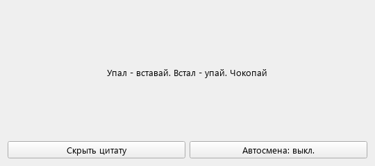
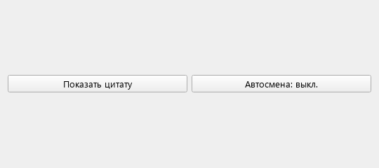
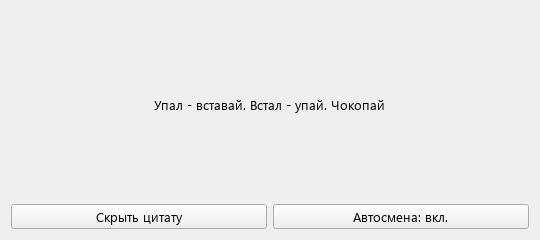
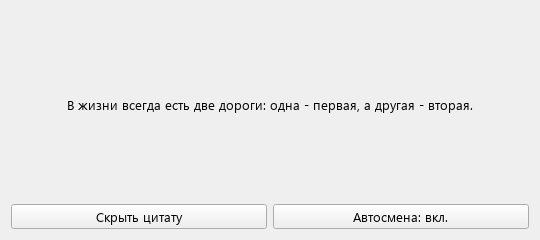

# Библиотека цитат Джейсона Стейтема

Сквозной проект по дисциплине «Основы кроссплатформенного программирования»: одно окно с девятью шуточными цитатами в стиле интернет-мемов и двумя кнопками.

Для запуска откройте `JasonStathamQuotes.pro` в Qt Creator, выберите комплект Qt Widgets с поддержкой C++17, соберите и запустите проект.

## Из лабораторной № 2 — «Дерево объектов Qt и автоматическое удаление виджетов»

Добавлена кнопка «Показать/скрыть цитату». При показе создаётся `QLabel` с родителем — главным окном. При скрытии метка удаляется через `deleteLater()`, а при закрытии окна дочерние объекты удаляются автоматически.

Сообщения `qDebug()` показывают создание и уничтожение метки. Для указателя на неё используется `QPointer`.

**Цитата показана — метка создана:**

**Цитата скрыта — метка удалена:**

## Из лабораторной № 3 — «QTimer, лямбда-слоты и динамические соединения»

Добавлена кнопка «Автосмена», которая запускает и останавливает `QTimer`. Каждые пять секунд он показывает следующую цитату; после девятой снова появляется первая.

Кнопки и сигнал `timeout()` подключены к лямбда-слотам с контекстом главного окна. При скрытии цитаты автосмена останавливается; включение автосмены при скрытой цитате снова показывает её.

**Автосмена включена:**

**Через пять секунд показана следующая цитата:**

